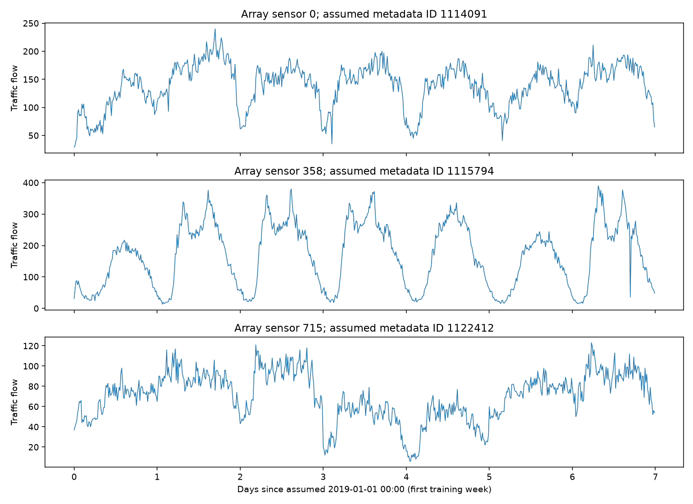
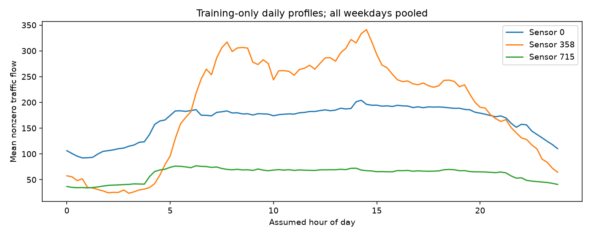
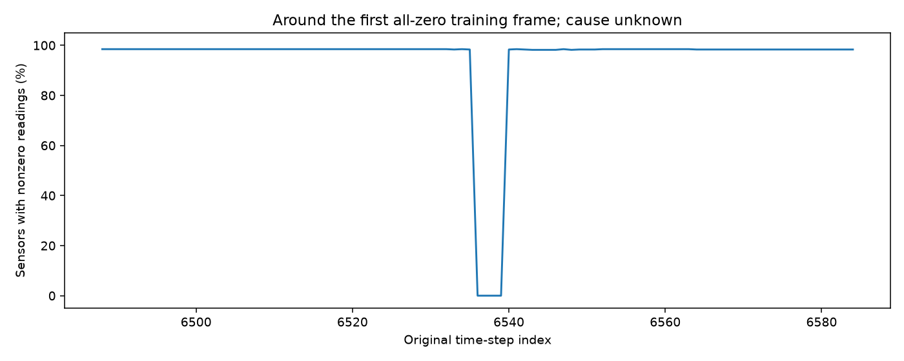

# Source data audit

Executed November 17, 2026 with `python scripts/audit_data.py` in the existing `pml`
environment. Source files were read without modification. No packages were
installed. Matplotlib was already available and used a temporary cache because
its default configuration directory was not writable.

## Observed values

| Check | Result |
| --- | --- |
| Shape / dtype | `(35040, 716, 1)` / `float64` |
| Nonfinite / negative readings | 0 / 0 |
| Range | 0–999 |
| Zero readings | 563,841 of 25,088,640 (2.2474%) |
| Entirely zero frames | 6536, 6537, 6538, 6539 |
| Entirely zero sensors over full array | None |
| Per-sensor nonzero coverage min / median / max | 0.2740% / 99.9886% / 99.9886% |

| Split | Zero readings (%) | Entirely zero sensors (array indices) |
| --- | ---: | --- |
| Training | 1.6880 | 146, 147, 238, 336 |
| Validation | 2.9116 | 11, 47, 146, 147, 190, 214, 215, 222, 551, 561, 632 |
| Test | 3.2614 | 11, 47, 108, 109, 150, 171, 179, 189, 190, 214, 215, 222, 226, 227, 390, 551, 561, 691, 692, 693 |

Coverage means the fraction of nonzero readings, not independently verified
measurement validity. Zero-target masking excludes all targets from a sensor
that is zero throughout an evaluation split. Aggregate scores therefore do not
describe successful predictions at every sensor. Report valid-target coverage
with accuracy and handle empty per-sensor groups explicitly.

The four training-only zero sensors explain why the seasonal baseline needs a
global nonzero fallback. No source values were filled or removed.

## Metadata

All 716 rows match the sensor count. ID and ID2 are unique, required fields are
present, fields are nonempty, and every row is District 11. Coordinates are
finite, within legal latitude/longitude bounds, and have no duplicate pairs.

- Latitude: 32.544296 to 33.406738.
- Longitude: -117.591561 to -116.880704.

These structural checks do not prove that each metadata row matches the same
traffic column. Original row order was preserved. ID2 is a source-network index,
not an index to use directly against the 716-sensor array.

## Training-only plots and interpretation

Sensors 0, 358, and 715 were selected by fixed array positions, not by forecast
performance. These are illustrative examples, not a representative sample of
all sensors.



The examples show repeating rises and falls, differing flow magnitudes, and
variation between days. This motivates studying temporal patterns while also
examining sensor-specific errors.



Profiles average nonzero training readings at each assumed time slot, pooling
weekdays. Sensor 358 shows distinct morning and afternoon peaks; the other two
examples have different profile shapes and magnitudes. These curves are not
the weekday-specific seasonal table and do not establish model performance.



All sensors drop to zero together across four consecutive frames. Their cause
is unknown. Under the reconstructed calendar, the first is March 10, 2019 at
02:00; this is an assumed label, not a timestamp observed in the file. No
timezone, daylight-saving adjustment, or cause is established by this audit.

## File identity and rerunning

SHA-256 values match the earlier source inspection and copied files:

```text
flowsd.npz
7aaf031a573bc27451360dee9d74e9359eb8205194077bf922a7a6b4432f771c
sd_meta.csv
c72a22095d1353bc38e6cd21daa9c17602023775dada1d84420c1b721e177e4a
```

Run from the project root with a new plot directory:

```bash
python scripts/audit_data.py --output-dir reports/data_audit_v2
```

The script refuses to overwrite existing named audit plots. It prints numerical
findings to the terminal; this document records the observed first run. The audit
inspects test data quality but does not evaluate test predictions or tune models.
Timestamp provenance, exact flow measurement semantics, zero meanings, and
sensor-column correspondence remain unresolved.
