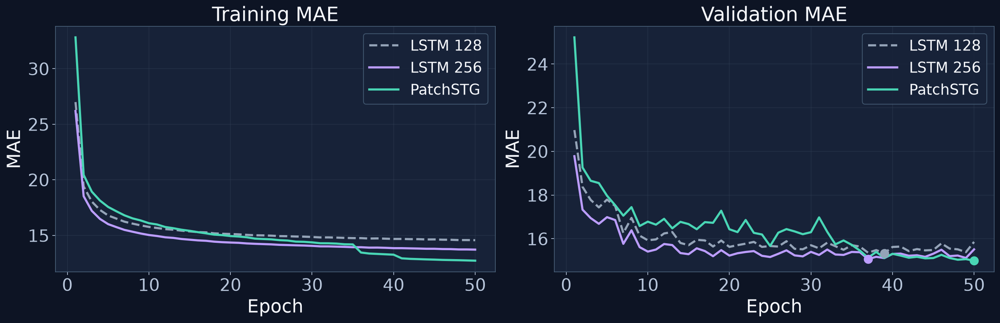
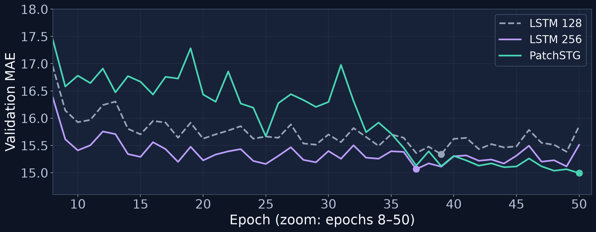
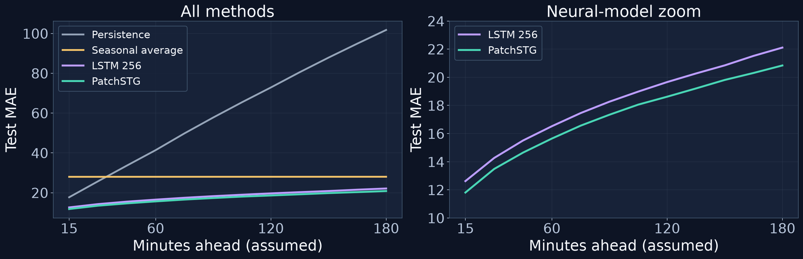
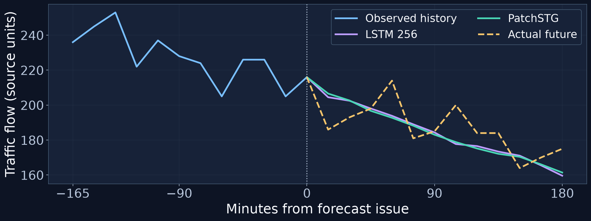
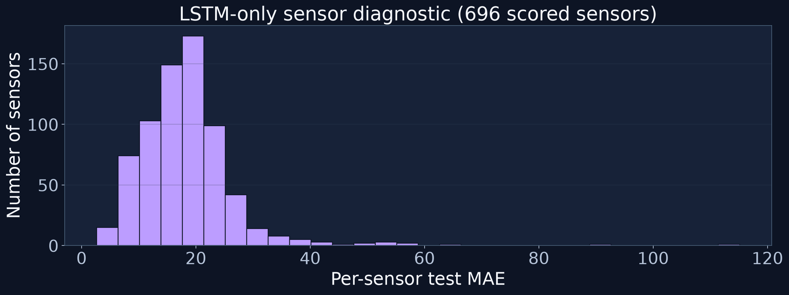

# Traffic forecasting: contextual LSTM versus PatchSTG

## Research question and scope

How do a contextual temporal LSTM and an integrated spatial-attention PatchSTG
system compare when predicting the next 12 traffic readings from the previous
12 readings? The LSTM directly applies the course method. Persistence and seasonal
average provide simple reference forecasts. BigST and the unfinished LSTM width
384 are deferred. This report describes completed recorded experiments, rather
than a proposal for new training.

PatchSTG is integrated with its implementation, configurations, spatial maps,
training records and saved evaluation. Its existing completed run is reused.
No training, checkpoint loading or model inference is performed when rebuilding
this report or its figures.

## Data and shared protocol

The processed LargeST-SD array has shape **35,040 × 716 × 1**. We treat it as
2019 San Diego traffic flow with a 15-minute cadence, so 12 steps span three hours.
Cadence, calendar origin (2019-01-01) and metadata/sensor alignment remain
assumptions because the processed array itself has no timestamps or sensor IDs.

| Item | Setting |
| --- | --- |
| Train target interval | [0, 21024) |
| Validation target interval | [21024, 28032) |
| Test target interval | [28032, 35040) |
| History / horizon / stride | 12 / 12 / 1 |
| Normalization | One global training-only mean/std; zeros included |
| Target convention | Zero targets excluded; zero inputs retained; no imputation |
| Metrics | Pooled original-unit MAE, RMSE and MAPE; lower is better |
| Test coverage | 6,997 windows; 58,158,396 eligible forecast–target pairs |

Every window's targets stay inside one split. Earlier observed history can cross
a split boundary. Both learned models use the same target origins and lead-wise
mask coverage. Overlapping forecast pairs are correlated, not independent trials.

Persistence repeats the latest observation. Seasonal average uses nonzero
training means by sensor, weekday and time slot, with sensor/global fallbacks.

## Models and actual training settings

The contextual LSTM concatenates normalized flow (1), time-slot embedding (16),
weekday embedding (8) and sensor embedding (16): **41 values per historical step**.
It processes each sensor history independently with shared weights, two recurrent
layers and fresh states per window. The selected 256-unit model uses a linear
head to predict all 12 leads directly. It has **848,644 parameters**.

PatchSTG projects historical traffic/calendar channels, adds learned context to
width 192, gathers **16 patches × 64 positions**, applies five dual-attention
blocks, restores 716 original sensors and predicts 12 leads. Coordinates define
patches and training-derived similarity supplies padding positions. Depth
attention combines 64 positions within a patch; breadth attention jointly combines
16 matching positions across patches. In each attention stage, independently
projected Queries and Keys produce softmax weights, which multiply the separately
projected Values. The integrated adaptation has **2,284,844 parameters**.

| Setting | Contextual LSTM | PatchSTG |
| --- | --- | --- |
| History / horizon | 12 / 12 | 12 / 12 |
| Calendar / sensor identity | Yes | Yes |
| Other sensors' current histories | No | Through spatial attention |
| Completed epochs / batch / seed | 50 / 4 / 2023 | 50 / 4 / 2023 |
| Optimizer | Adam | AdamW |
| Learning rate | 0.001 fixed | 0.002 initially; ×0.5 at epoch ends 1, 35, 40 |
| Weight decay / gradient clipping | None / none | 0.0001 / norm 5 |
| Selection | Lowest full validation MAE | Lowest full validation MAE |

Equal epochs align data passes, not compute, capacity or tuning budgets.

## Validation selection and learning curves

| Candidate | Completed epochs | Selected epoch | Validation MAE |
| --- | ---: | ---: | ---: |
| LSTM 128 | 50 | 39 | 15.3385 |
| LSTM 256 | 50 | 37 | 15.0656 |
| PatchSTG | 50 | 50 | 14.9936 |

Widths 128 and 256 each completed 50 epochs. The original three-width plan was
narrowed before the contextual test pass; width 384 is unfinished, not a rejected
completed candidate. Width 256 was selected at epoch 37 using validation only.
PatchSTG selected epoch 50.





The larger LSTM lowers training error, but its validation improvement over width
128 is modest. Both LSTM candidates have worse final validation errors than their
selected checkpoints. PatchSTG starts with higher error but ends with the lowest
recorded validation MAE (14.9936 versus 15.0656). Its different optimization prevents
attributing the trajectory solely to architecture. Training metrics pool evolving
weights; validation evaluates completed-epoch frozen weights.

These are actual stored histories for all three completed runs. The compact
[plot data](../presentation/slide_data.json) retains all 150 epoch records and
original report hashes so another PC can rebuild the figures without local runs.

## Frozen test results

| Model | MAE | RMSE | MAPE (%) |
| --- | ---: | ---: | ---: |
| Persistence | 60.7825 | 94.3350 | 41.7801 |
| Seasonal average | 28.0045 | 53.3906 | 19.9964 |
| Contextual LSTM 256 | 18.1696 | 31.9485 | 12.0646 |
| PatchSTG | 17.1943 | 29.1370 | 11.1706 |

PatchSTG records the lowest error on all three metrics. Its MAE is **0.9753
flow units lower**, a **5.37% reduction relative to LSTM**. Equivalently,
LSTM MAE is 5.67% higher relative to PatchSTG; the denominators differ.
These are single-seed observed differences, not a significance result.

The LSTM has **37.1% of PatchSTG's parameter count**, while retaining competitive
accuracy. Parameter count measures capacity/storage; it does not establish faster
inference. Timing was not controlled between the systems.

## Forecast distance: both learned models



| Assumed minutes ahead | LSTM MAE | PatchSTG MAE | LSTM minus PatchSTG |
| --- | ---: | ---: | ---: |
| 15 | 12.6201 | 11.8080 | 0.8121 |
| 30 | 14.2680 | 13.4866 | 0.7814 |
| 45 | 15.5069 | 14.6465 | 0.8604 |
| 60 | 16.5213 | 15.6450 | 0.8763 |
| 75 | 17.4568 | 16.5619 | 0.8949 |
| 90 | 18.2672 | 17.3399 | 0.9274 |
| 105 | 18.9844 | 18.0584 | 0.9260 |
| 120 | 19.6602 | 18.6190 | 1.0412 |
| 135 | 20.2702 | 19.2063 | 1.0640 |
| 150 | 20.8472 | 19.8116 | 1.0356 |
| 165 | 21.5214 | 20.3081 | 1.2133 |
| 180 | 22.1115 | 20.8403 | 1.2713 |

PatchSTG has lower recorded MAE at all 12 leads. The absolute gap grows from about
0.81 at 15 minutes to 1.27 at 180 minutes. Relative gains do not establish a
monotonically increasing spatial advantage. Persistence deteriorates sharply;
seasonal average is relatively flat. The right-hand zoom makes the neural gap
visible while the left plot preserves all-baseline context. This result is
consistent with spatial/context modeling being useful, but does not isolate its
causal contribution.

## A matched forecast example



This uses the **first chronological replay origin and first sensor** (sensor
1114091), chosen by position rather than favorable error.
Both forecasts are cached display-rounded outputs from the existing comparison
replay. Actual future observations are shown for inspection and were not model
inputs. A single example illustrates the task; aggregate metrics establish the
recorded overall comparison.

## Sensor variation and coverage



There are **696 sensors with eligible test targets and 20 without**. The right
tail identifies difficult cases worth investigating. This histogram is explicitly
LSTM-only: no matching full PatchSTG per-sensor metrics were saved in the available
aggregate report. The limited cached replay is not a substitute for a full-test
sensor evaluation. No comparative histogram is invented. Overall pooled MAE is
not generally the unweighted average of sensor MAEs. Masked zeros may represent
missingness or true zero flow; their meaning is unresolved.

## Interpretation, fairness and limitations

Both learned systems outperform the simple baselines. PatchSTG is more accurate
in this recorded comparison; the contextual LSTM offers lower parameter count.
A plausible explanation is that PatchSTG can exchange traffic information between
sensors, while the shared LSTM only sees its own sensor's history and identity.
However, capacity, coordinates/similarity, optimizer, learning-rate schedule,
regularization and search effort also differ. The experiment cannot identify
which factor caused the gap. Context, width and layers also changed together
from the small LSTM, so that earlier improvement is not an embedding ablation.

Only one seed and one network were studied. The test period had already been
observed before the contextual redesign; it is reused rather than newly unseen.
The contextual checkpoint was selected by validation, but this does not erase
that earlier exposure. Do not tune further on these results while claiming a
fresh test. Calendar and sensor pairing remain assumptions. The integrated
PatchSTG is an adapted implementation rather than an official full-paper
reproduction. No statistical significance, scalability or controlled speed claim
is established. Multiple seeds, controlled context/spatial ablations and a new
evaluation period are future work, not completed results.

## Reproduce documents without rerunning experiments

From the project root:

```bash
python scripts/build_project_report.py
python scripts/build_presentation.py
```

The first command refreshes this report and figures from tracked saved results.
The second rebuilds the decks in `presentations/`. Neither trains or evaluates a
model. Raw data and checkpoints are not needed for these document refreshes.
For deliberate model execution see [commands](../../docs/commands.md).

Measured evidence is preserved: [LSTM test](report.json), [selection](selection.json),
[comparison](comparison.json), and [PatchSTG test](../patchstg_sd_seed2023_test_v1.json).
[Build provenance](report_build.json) records source hashes. Original experimental
snapshots under `reproducibility/` remain intact. The presentation and report use
the same figure-generation functions and saved data.

## References

- Fang et al. *Efficient Large-Scale Traffic Forecasting with Transformers: A Spatial Data Management Perspective*. KDD 2025. [Paper](https://arxiv.org/abs/2412.09972v2).
- Liu et al. *LargeST: A Benchmark Dataset for Large-Scale Traffic Forecasting*. NeurIPS 2023. [Paper](https://arxiv.org/abs/2306.08259).
- [Integrated implementation guide](../../docs/patchstg/README.md) and [attribution](../../THIRD_PARTY_NOTICES.md).
